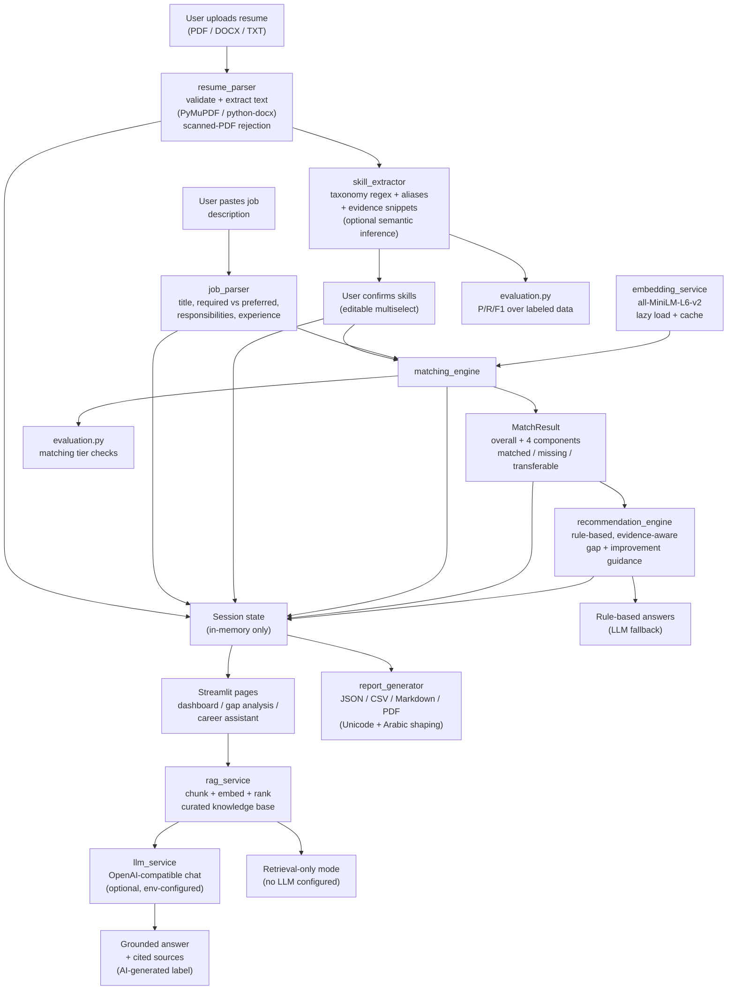
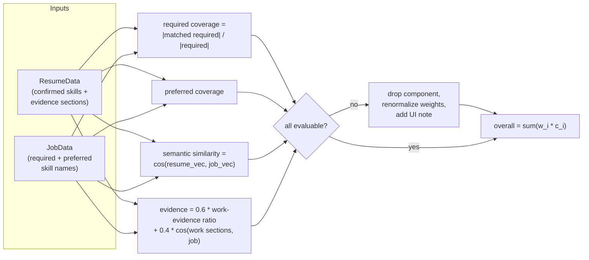

# AI Job Assistant - Architecture

This document explains how data flows through the system, what each module
is responsible for, and which capabilities are implemented versus planned.
It complements `README.md` (installation, algorithms, evaluation) and is
written to be walked through in a technical interview.

## 1. High-level data flow

## 2. Module responsibilities

| Module | Responsibility | Key public API |
|--------|----------------|----------------|
| `config/settings.py` | Every tunable value; env parsing; weights normalization; LLM config (never printed) | `SETTINGS`, `ScoringWeights`, `LLMConfig` |
| `src/models.py` | Pydantic data models shared everywhere | `ResumeData`, `JobData`, `MatchResult`, `SkillGapItem`, ... |
| `src/exceptions.py` | Typed error hierarchy mapped to user messages | `ResumeParseError`, `InsufficientTextError`, `ModelNotAvailableError`, ... |
| `src/utils.py` | Text normalization, evidence snippets, log-safe masking | `normalize_text`, `make_snippet`, `mask_sensitive` |
| `src/resume_parser.py` | File validation, PDF/DOCX/TXT extraction, section splitting with char spans, name/contact/summary detection | `parse_resume`, `parse_resume_text` |
| `src/job_parser.py` | JD section splitting, title/experience/education/certs/keywords, required-vs-preferred assignment by section | `parse_job_description` |
| `src/skill_extractor.py` | Taxonomy loading + regex compilation with boundary lookarounds, evidence attribution, dedupe, optional semantic inference | `extract_skills`, `canonicalize_skill_names`, `load_taxonomy` |
| `src/embedding_service.py` | Lazy model wrapper, chunked mean-pooling for long text, taxonomy-embedding cache, deterministic `DummyEmbeddingService` for tests | `get_embedding_service`, `EmbeddingService.embed_long_text` |
| `src/matching_engine.py` | The 4-component weighted score, unavailable-component renormalization, transferable-skill detection | `MatchingEngine.compute_match` |
| `src/recommendation_engine.py` | Priority learning paths, honest resume-improvement drafts, interview topics, rule-based assistant answers | `generate_recommendations`, `rule_based_answer` |
| `src/llm_service.py` | OpenAI-compatible HTTP adapter, timeouts, sanitized errors, Pydantic-validated JSON replies | `LLMService.chat`, `LLMService.chat_json` |
| `src/rag_service.py` | Knowledge loading, heading-based chunking, in-memory cosine index, grounded prompt builder | `get_cached_rag_index`, `build_assistant_prompt` |
| `src/evaluation.py` | Live metrics from bundled labeled datasets | `evaluate_skill_extraction`, `evaluate_matching` |
| `src/report_generator.py` | JSON/CSV/Markdown/PDF exports; bundled fonts + HarfBuzz shaping for Arabic | `build_report_data`, `generate_pdf_report` |
| `src/privacy.py` | Session clearing, log redaction, LLM disclosure text | `clear_session_state`, `LLM_DISCLOSURE_ITEMS` |
| `src/i18n.py` | EN/AR string tables, RTL helpers | `translate`, `is_rtl_language` |
| `src/ui_helpers.py` | Sidebar (language, LLM status, clear data, nav), headers, demo loaders | `render_sidebar`, `T` |

## 3. Session-state contract (UI <-> logic)

Pages never import each other. State keys (all in-memory, wipeable):

| Key | Type | Set by | Consumed by |
|-----|------|--------|-------------|
| `lang` | `"en" \| "ar"` | sidebar selectbox | every page via `T()` |
| `resume_data` | `ResumeData \| None` | page 1 / demo loader | pages 2-4 |
| `confirmed_skills` | `list[str]` | page 1 editor | pages 2-4 |
| `job_input` | `str` | page 2 textarea | page 2 |
| `job_data` | `JobData \| None` | page 2 analyze | pages 2-4 |
| `match_result` | `MatchResult \| None` | page 2 analyze | pages 2-4 |
| `recommendations` | `RecommendationSet \| None` | page 2 analyze | page 4 |

Any change to inputs invalidates downstream keys (page 1 clears
`match_result` when the resume changes; page 2 recomputes on demand).

## 4. Scoring data flow (detail)

Defaults: `0.45 / 0.15 / 0.25 / 0.15`. If e.g. the JD has no preferred
skills, the remaining three weights are rescaled to sum to 1.0 and the
dashboard explains the exclusion. If *nothing* is evaluable, `overall`
is `None` and no number is displayed.

## 5. Implemented vs future enhancements

**Implemented (verified by tests and/or the smoke-tested UI):**

- PDF/DOCX/TXT parsing with scanned-PDF rejection, corrupted-file and
  empty-input handling
- Taxonomy skill extraction with aliases, boundaries, evidence, dedupe;
  optional labeled semantic inference
- JD parsing (title, required/preferred, responsibilities, experience,
  education, certifications, keywords)
- Weighted semantic matching with renormalization and transferable skills
- Skill-gap analysis with priorities and learning directions
- RAG: chunking, in-memory cosine index, top-k retrieval, grounded cited
  prompting, retrieval-only mode
- LLM adapter: env-configured, timeout + sanitized errors, JSON schema
  validation, rule-based fallback everywhere
- Reports: JSON, CSV, Markdown, PDF (Unicode + Arabic shaping)
- Evaluation page: live micro P/R/F1 and matching tier-order checks
- Bilingual UI with RTL support; session clearing; privacy disclosures
- 107 automated tests (offline; LLM HTTP mocked; embeddings dummied)

**Future enhancements (not implemented - do not claim otherwise):**

- OCR for scanned resumes
- Persistent history, multilingual taxonomies, hybrid BM25+vector
  retrieval, LLM-based JD extraction with human review, Docker/CI
  deployment recipe, larger independently labeled evaluation corpora

## 6. Extension points

- **New skills:** append to `data/skills_taxonomy.json` (aliases optional);
  extraction, matching, gap analysis and evaluation pick it up
  automatically (embeddings for new names are computed on first use).
- **New knowledge:** drop a `.md` file (with `#`/`##` headings) into
  `data/knowledge_base/`; the index rebuilds on signature change.
- **New provider:** any OpenAI-compatible endpoint works via `.env`; no
  code changes.
- **New score component:** add a weight to `ScoringWeights`, compute it in
  `MatchingEngine`, add a label; renormalization is already generic.
